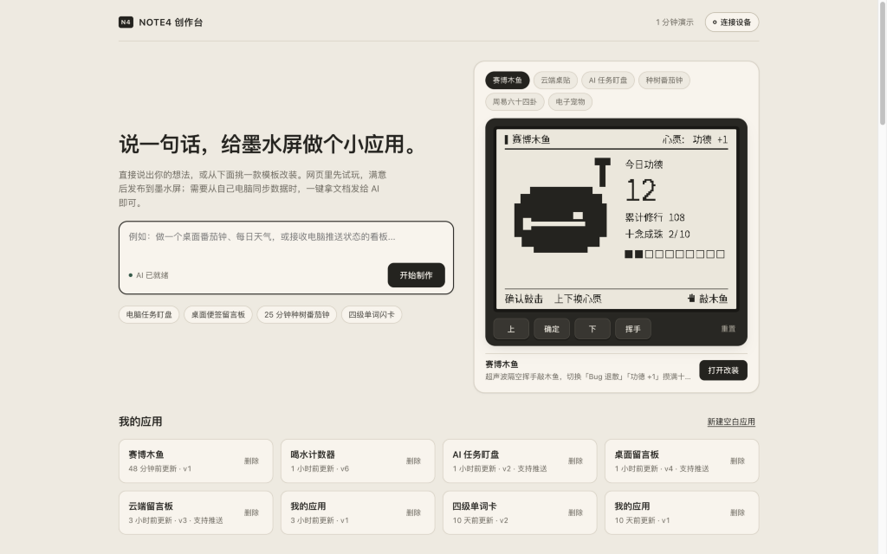
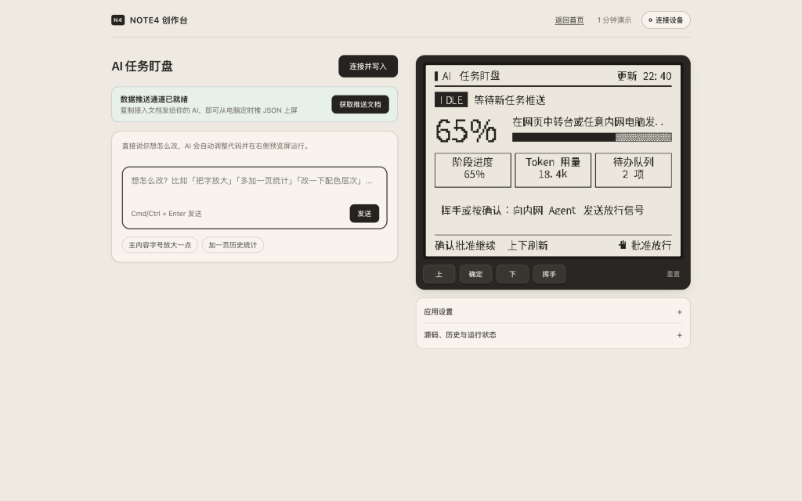
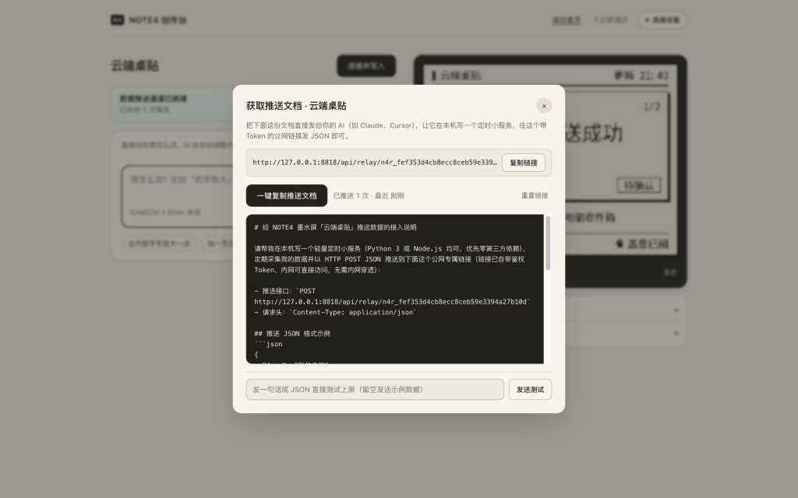
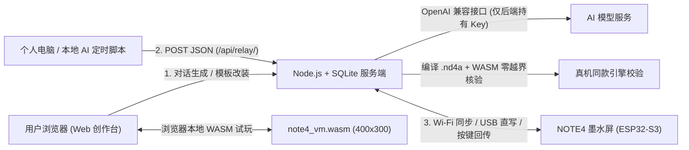

<div align="center">

# NOTE4 墨水屏对话创作台

**说一句话，给桌面墨水屏做个小应用。**

面向 **ZECTRIX NOTE4（4.2" 400×300 E-Ink · ESP32-S3 · 三键 + 超声波挥手）** 的开源 Web 创作平台<br>
浏览器 WASM 真机同构模拟 · 受约束 AI 对话生成 · 一键文档电脑推送 · 41 款内置模板

<p>
  <a href="LICENSE"></a>
  
  
  
  
</p>

<p>
  <a href="#效果展示">效果展示</a> ·
  <a href="#核心特性">核心特性</a> ·
  <a href="#系统架构">系统架构</a> ·
  <a href="#快速开始">快速开始</a> ·
  <a href="#电脑推送数据用法">电脑推送用法</a> ·
  <a href="#致谢与参考仓库">致谢</a>
</p>

</div>

---

## 效果展示

<p align="center">
  
  <br>
  <sub>首页双栏创作台：左侧一句话描述需求，右侧设备同款 WASM 引擎直接试玩按键与挥手</sub>
</p>

<table>
  <tr>
    <td width="50%" align="center">
      
      <br>
      <sub><b>AI 对话工作台</b> · 实时热重载预览、次要设置折叠收纳</sub>
    </td>
    <td width="50%" align="center">
      
      <br>
      <sub><b>极简推送文档</b> · 复制文档发给本地 AI，自动写定时推送脚本</sub>
    </td>
  </tr>
  <tr>
    <td colspan="2" align="center">
      
      <br>
      <sub><b>内置模板库</b> · 覆盖电脑同步、效率专注、信息看板、生活日常与桌面小玩意，全部通过 400×300 零越界核验</sub>
    </td>
  </tr>
</table>

---

## 核心特性

| 模块 | 说明 |
| :--- | :--- |
| **真机同构 WASM 预览** | 浏览器内直接运行 `note4_vm.wasm` 与设备同款 16px 点阵字库，400×300 像素级还原黑白点阵快刷与 16 级灰阶，支持键盘 `↑` / `↓` / `Enter` / `W`（隔空挥手）零延迟试玩 |
| **AI 创作与自动核验** | 兼容任意 OpenAI 格式模型接口；AI 每次写完代码由服务端自动跑一遍 WASM 引擎核验 ES5 语法、单次回调耗时（< 800ms）、按键响应、断网容错与零像素越界，失败则自动打回自愈 |
| **极简 AI 推送文档（Relay）** | 无需公网 IP 或内网穿透；自动为需要电脑同步的应用签发带 Token 专属公网链接，并按源码首行 `// RELAY_JSON: {...}` 自动生成可直接发给 Claude / Cursor 的 Markdown 接入文档，同时支持屏幕按键回传 `/outbox` |
| **41 款开箱即用模板** | 内置云端桌贴、AI 任务盯盘、电脑副屏、种树番茄钟、百日热力格、艾宾浩斯复习、月历日程、A 股 K 线、实时汇率、赛博木鱼、周易六十四卦、三键像素地牢、电子宠物等 |
| **安全与低开销部署** | 模型 API Key 与上游地址仅存于服务端，公开 `/api/config` 严格脱敏；无长连接 SSE 空占，后台标签页自动暂停预览刷新，静态资源自带分层 `Cache-Control` 适配反向代理与 CDN 缓存 |

---

## 系统架构



---

## 快速开始

### 环境要求

- **Node.js 24+**（使用内置 `node:sqlite`，零外部数据库依赖）
- **Chrome / Edge 浏览器**（如需使用 WebSerial USB 直写、配网或首次刷机）

### 1. 安装依赖并启动本地创作台

```bash
npm --prefix server ci
PORT=8818 npm --prefix server run studio
```

启动后浏览器访问 `http://127.0.0.1:8818`。

> 首次启动时，`server/scripts/local.mjs` 会自动打包服务端代码，并将 `wasm/note4_vm.wasm` 与 `firmware/main/js_font16.bin` 同步到 `web/vendor/`。

### 2. 配置 AI 模型（可选，不配置也可试玩与手动编辑全部模板）

**方式 A：环境变量启动**（字段见 [`.env.example`](.env.example)）

```bash
MODEL_BASE_URL=https://api.deepseek.com/v1 \
MODEL_NAME=deepseek-chat \
MODEL_API_KEY=your-api-key \
PORT=8818 npm --prefix server run studio
```

**方式 B：网页配置**  
本地模式下点击右上角「配置 AI」填入接口地址、模型名和 API Key（仅持久化保存在本地 `server/.local/` 的 SQLite 中，不会暴露给前端）。

### 3. 生产环境自托管（VPS + Nginx / Cloudflare Tunnel）

```bash
cp .env.example .env
# 编辑 .env：设 NOTE4_LEGACY_DEV=false，填写 MODEL_*、PUBLIC_ORIGIN 与认证参数
NODE_OPTIONS="--max-old-space-size=192" npm --prefix server start
```

- 默认监听 `127.0.0.1:8787`（可通过 `PORT` 调整），推荐前置反向代理或 Cloudflare Tunnel 提供 HTTPS。
- 静态资源默认配置 `Cache-Control`（`index.html` 为 `no-cache`，版本号化 JS/CSS 为 1 小时，缩略图/WASM/点阵字库为 24 小时），降低回源负载。

---

## 电脑推送数据用法

开启数据推送通道后，在应用工作台点击 **「获取推送文档」** 即可一键复制带当前应用精确 JSON 字段的 Markdown 说明，直接发给你的本地 AI 帮你写定时推送小服务；也可以直接通过 HTTP 调用：

```bash
# 推送 JSON 状态或留言到墨水屏
curl -X POST "https://your-domain/api/relay/<token>" \
  -H "Content-Type: application/json" \
  -d '{"title":"构建完成","status":"DONE","progress":100,"text":"全部测试已通过"}'

# 读取墨水屏按「确定 / 挥手」回传的动作队列（可选）
curl "https://your-domain/api/relay/<token>/outbox"
```

---

## 常用开发与校验命令

```bash
# TypeScript 严格类型检查
npm --prefix server run check

# 在 WASM 引擎中校验全部 41 款内置模板（ES5 合法性、按键响应、400x300 零越界）
node tools/verify-templates.mjs

# 前端脚本语法检查
node --check web/studio.js && node --check web/demo.js
```

---

## 目录结构

```text
.
├── web/                 # 极简纸感 Web 创作台（HTML / CSS / ES Module JS / WASM 模拟器 / WebSerial 写入）
├── server/
│   ├── src/             # 平台核心（AI Agent、WASM 真机核验、ND4A 编译器、Relay 中转、41 款模板）
│   └── scripts/         # Node.js + SQLite 生产与本地宿主入口（local.mjs）
├── wasm/                # 浏览器与服务端共用的 NOTE4 WASM 引擎源码与产物
├── shared/              # 前后端与固件共享的协议、图标与角色定义
├── firmware/            # 设备端固件源码与许可说明（不含私有工厂波形头文件）
├── examples/            # 示例作品规范与编译好的 .nd4a 包
├── tools/               # 模板校验、契约测试与 USB 调试脚本
└── docs/screenshots/    # README 展示截图
```

---

## 致谢与参考仓库

本项目的显示驱动适配、墨水屏刷新策略、JS 沙箱执行引擎与网页端动效参考或使用了以下 **MIT License** 开源项目，在此致谢：

- **[ZECTRIX NOTE4 EPD Demo](https://github.com/itopinion/zectrix-note4-epd-demo)** (`MIT`) — 官方 NOTE4 墨水屏硬件显示驱动与演示素材参考
- **[InkBoy](https://github.com/kuslota/InkBoy)** (`MIT`) — 墨水屏高刷运动规划与刷新策略研究参考
- **[QuickJS](https://bellard.org/quickjs/) / [quickjs-emscripten](https://github.com/justjake/quickjs-emscripten)** (`MIT`) — 受限 ES5 JavaScript 运行时与 WASM 沙箱执行引擎
- **[Emil Kowalski Web Motion Skills](https://github.com/emilkowalski/skills)** (`MIT`) — Web 创作台网页端克制动效与交互节奏设计参考

---

## License

本项目基于 [MIT License](LICENSE) 开源。
