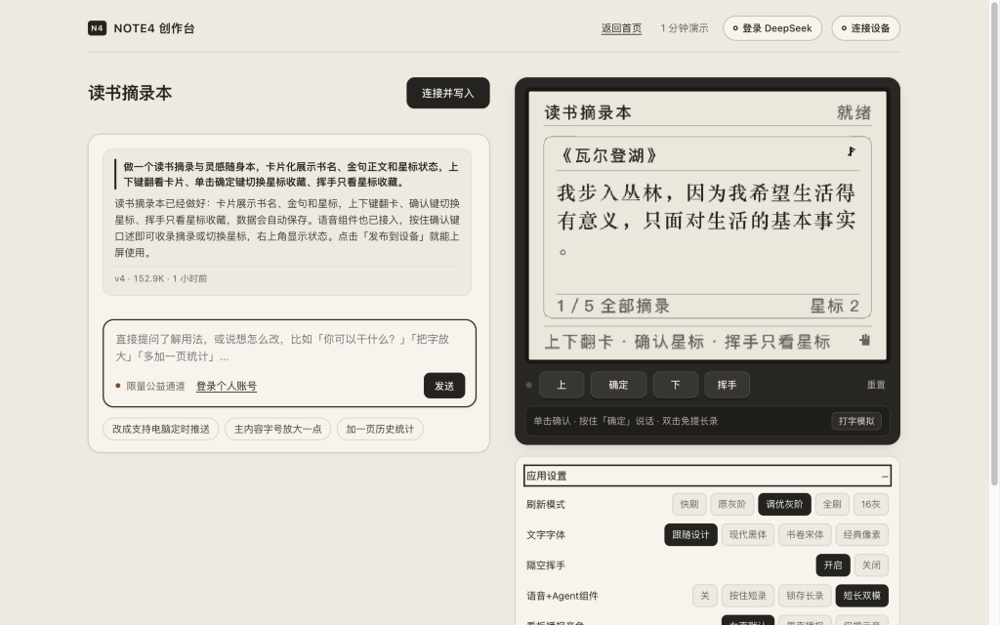
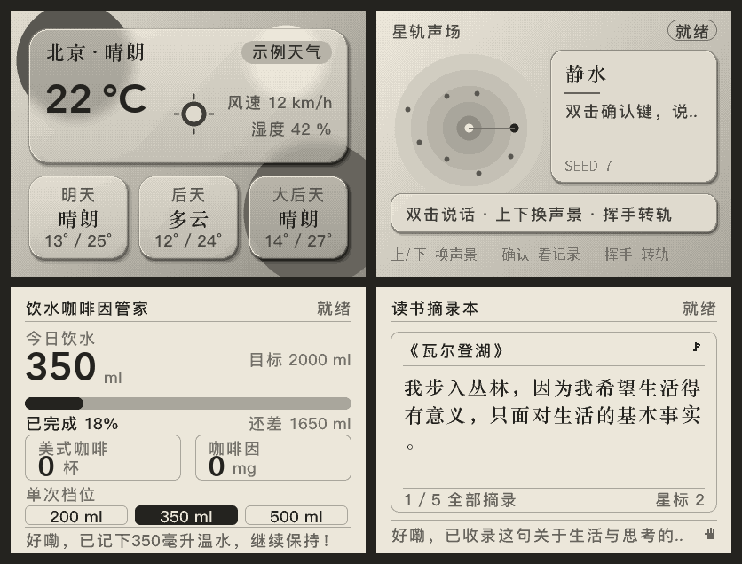
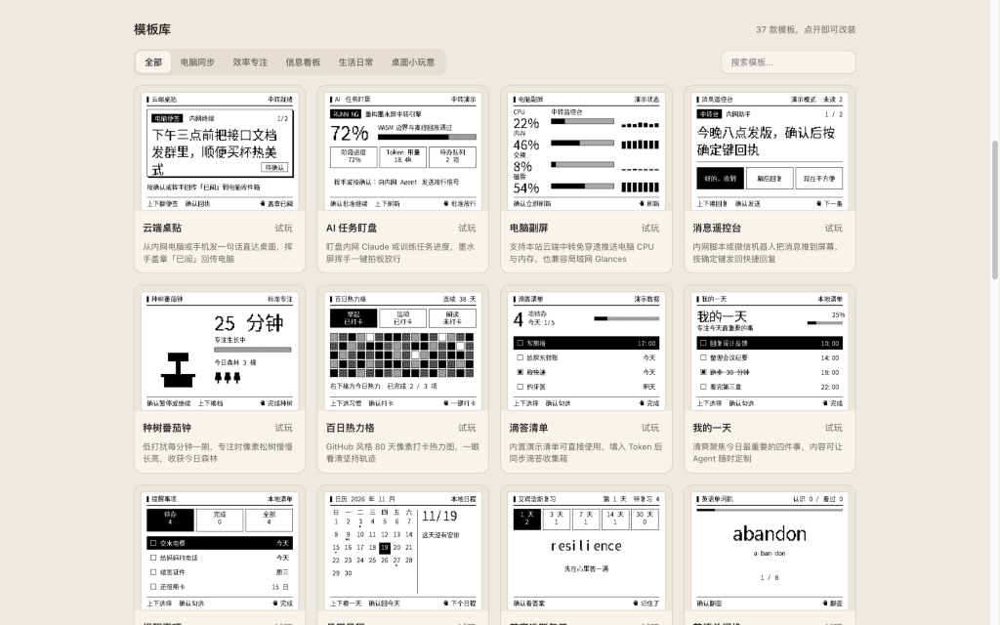
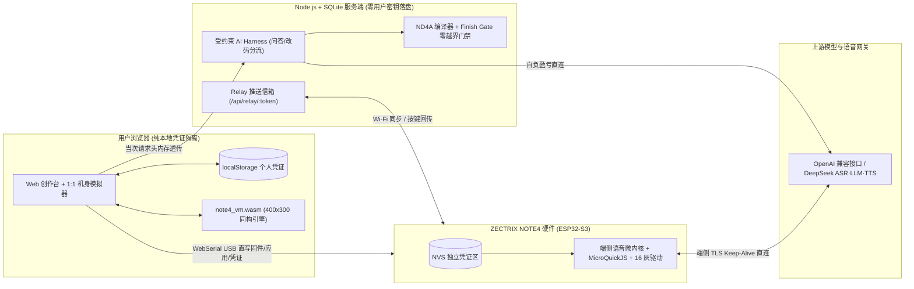

<div align="center">

# NOTE4 E-Ink Studio · 墨水屏对话创作台

**说一句话，给桌面墨水屏铸造一枚常显小应用。**

面向 **ZECTRIX NOTE4（4.2" 400×300 E-Ink · ESP32-S3 · 三键 + 超声波挥手 + 驻极体麦 / 扬声器）** 的端云一体开源创作平台<br>
1:1 机身硬件与语音真机模拟 · 无头 `voice()` Agent 组件 · 6,917 全字库双字体排版 · 浏览器隔离自负盈亏直连 · 48 款内置模板

<p>
  
  <a href="LICENSE"></a>
  
  
  
  
</p>

<p>
  <a href="#效果展示">效果展示</a> ·
  <a href="#v21-核心架构与特性">核心特性</a> ·
  <a href="#无头语音与-agent-标准组件">无头语音组件</a> ·
  <a href="#系统架构与硬件交互链路">系统架构</a> ·
  <a href="#快速开始">快速开始</a> ·
  <a href="#电脑推送数据用法">电脑推送</a> ·
  <a href="#致谢与参考仓库">致谢</a>
</p>

</div>

---

## 效果展示

<p align="center">
  
  <br>
  <sub><b>v2.1 对话创作与 1:1 真机模拟工作台</b> · 左侧支持咨询秒答与增量改码双模分流，右侧完整复刻物理三键长按说话、双击长录、字体切换与五档刷新波形</sub>
</p>

<p align="center">
  
  <br>
  <sub><b>端侧同构 WASM 400×300 像素实拍</b> · 左上：16 灰液态玻璃天气画报 ｜ 右上：AI 独立生成的「星轨声场」 ｜ 左下：无头语音组件驱动的「饮水咖啡因管家」 ｜ 右下：6,917 全字库粗宋排版的「读书摘录本」</sub>
</p>

<table>
  <tr>
    <td width="50%" align="center">
      
      <br>
      <sub><b>即开即玩双栏首页</b> · 一句话从零生成或基于现有模板改装</sub>
    </td>
    <td width="50%" align="center">
      
      <br>
      <sub><b>免穿透电脑数据推送</b> · 一键复制 Markdown 接口文档交由本地 AI 编写同步脚本</sub>
    </td>
  </tr>
  <tr>
    <td colspan="2" align="center">
      
      <br>
      <sub><b>48 款内置开箱即用应用</b> · 覆盖端侧语音看板、16 灰液态玻璃视觉、电脑同步盯盘、效率专注、实时行情与桌面奇物，100% 通过零越界门禁</sub>
    </td>
  </tr>
</table>

---

## v2.1 核心架构与特性

| 核心模块 | 技术细节与工程边界 |
| :--- | :--- |
| **端侧语音 + Agent 微内核** | ESP32-S3 固件内置双槽 PSRAM 环形录音缓冲（16kHz PCM WAV 边录边传、断网落盘重传、静音谷底智能切分）、24kHz 自适应预缓冲流式人声播报、动态 80MHz–240MHz DFS 调频，以及独立 DMA 静态帧缓冲防并发刷新故障 |
| **无头 `voice()` 标准组件** | 彻底解耦 UI 视觉与语音状态机：任意画风的应用只需声明 `role / state / tools`，一键接入「按住确认键短录或插话打断、双击免提长录、单击与上下键及挥手原交互零冲突保留」，内置单轮最多 4 次工具调用熔断保护 |
| **1:1 机身硬件模拟器** | 网页端运行与固件同源的 `note4_vm.wasm`；右侧黑框机身完整还原「单击确认 / 按住 380ms 拉起真实麦克风说话 / 双击免提长录 / 播报中途按住秒级打断」、5 柱实时音量波形与呼吸状态灯 |
| **6,917 全字库与字体自选** | 零动态分配 XIP 抗锯齿字库包：`sans`（20px 现代黑体）与 `serif`（24px 书卷粗宋）均完整收录 GB2312 一二级全部 6,763 汉字与常用口语字，配合 36px/48px 等宽大数字与 16px 像素字；支持玩家在应用设置中一键切换全局字体 |
| **零服务器落盘 · 自负盈亏直连** | 个人 DeepSeek 授权令牌或 API Key **严格仅保存在用户本机浏览器 `localStorage` 与自有硬件 NVS 分区**，服务端数据库零落盘；登录后自动接管创作台 AI 与语音通道（默认 `deepseek-flash`，支持官方模型下拉切换），具备无轮询低频官网退出同步清态机制 |
| **Finish Gate 真机门禁与问答分流** | 每次代码变更均经服务端 WASM 引擎自动核验 ES5 语法、单帧回调预算、按键响应、断网容错、图层遮挡与 `400×300` 零像素越界；纯咨询问题（如询问平台玩法）自动分流，零工具调用 1.5 秒直答不误改代码 |
| **极简电脑推送通道（Relay）** | 无需公网 IP 或内网穿透；按源码首行 `// RELAY_JSON: {...}` 自动签发带独立令牌的推送入口与 Markdown 接入文档，同时支持墨水屏按键或挥手动作回传 `/outbox` |

---

## 无头语音与 Agent 标准组件

平台将端侧录音、流式转写、工具调用循环与人声播报封装为无头标准组件 `voice({ role, state, tools })`。AI 生成应用或开发者手写 ES5 脚本时无需绑定任何固定界面模板，十余行代码即可为任意自定义画面赋予自然语音操控：

```javascript
var S = load('drink', { ml: 0, goal: 2000, step: 250 });

var V = voice({
  role: '干练贴心的桌面饮水管家',
  state: function () { return S; },
  tools: [
    {
      name: 'log_water',
      desc: '记录喝水量（毫升）',
      params: { type: 'object', properties: { ml: { type: 'number' } }, required: ['ml'] },
      run: function (a) {
        S.ml += Math.max(50, Math.min(2000, Number(a.ml) || 250));
        save('drink', S);
        return { total_ml: S.ml, remain_ml: Math.max(0, S.goal - S.ml) };
      }
    }
  ]
});

function draw() {
  ui.clear(15);
  ui.font('sans');
  ui.text(16, 12, '饮水管家', 1, 0);
  ui.text(340, 12, V.badge(), 1, 5);        // 右上角短状态：就绪 / 录音中 / 思考中 / 播报中
  ui.font('display_lg');
  ui.text(16, 56, String(S.ml), 1, 0);      // 48px 等宽大数字表盘
  ui.font('sans');
  V.bar(16, 268, 368, '按住确认键说喝了多少水'); // 底部单行反馈，超长回复自动平滑滚屏
  ui.present();
}
```

---

## 系统架构与硬件交互链路



### 机身按键与手势无冲突契约

- **上下键（`up` / `down`）**：始终 100% 交由当前应用处理（翻页、选档、切视图）。
- **超声波隔空挥手（`wave`）**：始终 100% 交由当前应用处理（快捷打卡、切声景、盖章回传）。
- **中间确认键（`ok`）**：
  - **短按单击**：触发应用原有 `on_key('ok')`（若正处于免提长录中，则单击结束长录并提交）。
  - **按住不放（≥ 380ms）**：立即打断正在播放的语音并启动按住短录（PTT），松手即识别执行。
  - **快速双击**：切入免提锁存长录（支持会议纪要或连续口述，最长 60 分钟分段流式上传）。
- **下键长按（800ms）**：全局硬件级安全停止（切断屏幕高压与功放并保持 USB 调试常通）。

---

## 快速开始

### 环境要求

- **Node.js 24+**（使用内置 `node:sqlite`，零外部数据库依赖）
- **Chrome / Edge 桌面浏览器**（如需使用 WebSerial USB 直写设备、配网或首次刷入固件）

### 1. 安装依赖并启动本地创作台

```bash
npm --prefix server ci
PORT=8788 npm --prefix server run studio
```

启动后打开浏览器访问 `http://127.0.0.1:8788`。

> 首次启动时，`server/scripts/local.mjs` 会自动打包服务端代码，并将 `wasm/note4_vm.wasm`、`firmware/main/js_font16.bin` 与 `firmware/main/js_fonts_aa.bin` 同步到 `web/vendor/`。

### 2. 绑定 AI 账号（支持零服务端配置的个人浏览器直连）

- **推荐方式（个人自负盈亏，服务端零配置）**：直接打开网页右上角 **「登录 DeepSeek」**，扫码或填入个人 `sk-...` API Key。凭证仅保存在当前浏览器本地，立即接管应用生成与右侧 1:1 语音模拟器；插上 USB 数据线即可一键将凭证直写进你自己的 NOTE4 硬件。
- **可选方式（服务端公共兜底通道）**：参考 [`.env.example`](.env.example) 配置 `MODEL_BASE_URL`、`MODEL_NAME` 与 `MODEL_API_KEY`，为未登录个人账号的访客提供公共生成通道。

### 3. 生产环境自托管（VPS + Nginx / Cloudflare Tunnel）

```bash
cp .env.example .env
# 编辑 .env：设 NOTE4_LEGACY_DEV=false，按需填写 PUBLIC_ORIGIN 与认证参数
NODE_OPTIONS="--max-old-space-size=256" npm --prefix server start
```

---

## 电脑推送数据用法

开启数据推送通道后，在工作台点击 **「获取推送文档」** 即可一键复制包含当前应用精确 JSON 字段的说明文档，发给本地 AI 自动编写定时同步脚本，或直接通过 `curl` 推送：

```bash
# 推送 JSON 状态或卡片数据到墨水屏
curl -X POST "https://your-domain/api/relay/<token>" \
  -H "Content-Type: application/json" \
  -d '{"title":"构建完成","status":"DONE","progress":100,"text":"全部测试已通过"}'

# 读取墨水屏按「确定 / 挥手」回传的动作队列
curl "https://your-domain/api/relay/<token>/outbox"
```

---

## 常用开发与校验命令

```bash
# TypeScript 严格类型检查
npm --prefix server run check

# 在 WASM 引擎中逐一核验全部内置模板（ES5 语法、回调耗时、按键响应、400x300 零像素越界）
node tools/verify-templates.mjs

# 前端模块语法检查
node --check web/studio.js && node --check web/voice-ui.js && node --check web/demo.js

# 重新生成 6,917 全字库抗锯齿多字体包（输出 .bin 与 .bin.zz）
python3 tools/build-aa-fonts.py
```

---

## 目录结构

```text
.
├── web/                 # 纸感 Web 创作台（1:1 硬件语音模拟器、WASM 画布、WebSerial 直写与刷机）
├── server/
│   ├── src/             # 平台核心（AI Harness、无头语音组件注入、WASM Finish Gate、ND4A 编译器、48 款模板）
│   └── scripts/         # Node.js + SQLite 本地与生产宿主入口（local.mjs）
├── wasm/                # 浏览器与服务端同构运行的 NOTE4 WASM 虚拟机源码与编译产物
├── shared/              # 前后端与固件共享的通信协议与图形常量定义
├── firmware/            # ESP32-S3 端侧固件源码（语音 Agent 微内核、MicroQuickJS、多刷显示管线）
├── examples/            # 示例作品规范与预编译 .nd4a 应用包
├── tools/               # 全字库构建器、全量模板核验与边界契约测试脚本
└── docs/screenshots/    # README 实机与工作台展示截图
```

---

## 致谢与参考仓库

本项目的显示驱动适配、墨水屏刷新策略、JS 沙箱执行引擎与网页端交互节奏参考或使用了以下 **MIT License** 开源项目，在此致谢：

- **[ZECTRIX NOTE4 EPD Demo](https://github.com/itopinion/zectrix-note4-epd-demo)** (`MIT`) — 官方 NOTE4 墨水屏硬件显示驱动与外设参考
- **[InkBoy](https://github.com/kuslota/InkBoy)** (`MIT`) — 墨水屏高刷运动规划与刷新策略研究参考
- **[QuickJS](https://bellard.org/quickjs/) / [MicroQuickJS](https://bellard.org/mquickjs/)** (`MIT`) — 嵌入式受限 ES5 JavaScript 沙箱引擎
- **[Emil Kowalski Web Motion Skills](https://github.com/emilkowalski/skills)** (`MIT`) — Web 创作台克制动效与交互阻尼设计参考

---

## License

本项目基于 [MIT License](LICENSE) 开源。
